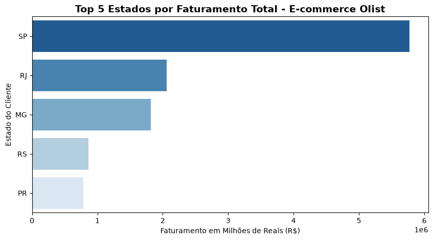

# Otimização de Performance Comercial e Gargalos Logísticos no E-commerce (Olist)

## 📌 Contexto e Problema de Negócio
No cenário de e-commerce altamente competitivo, monitorar a receita e a eficiência das entregas é vital para a retenção de clientes e saúde financeira da empresa. Este projeto simula o papel de um Analista de Dados avaliando o histórico de vendas da plataforma brasileira **Olist**. 

O objetivo desta análise foi responder a duas perguntas críticas da diretoria executiva:
1. **Onde estão nossos clientes e qual o faturamento real gerado por região?** (Foco em Marketing e Vendas)
2. **Onde estão nossos maiores gargalos de entrega e atrasos?** (Foco em Eficiência Operacional e Logística)

---

## 🛠️ Tecnologias e Ferramentas Utilizadas
* **Python 3.14:** Motor principal de processamento e análise.
* **Pandas:** Utilizado para a limpeza de dados, tratamento de tipos (conversão de strings para datas), filtros de regras de negócio (pedidos de sucesso vs. cancelados) e cruzamento de bases distintas (`pd.merge`).
* **Matplotlib & Seaborn:** Criação de visualizações gráficas limpas e em degradê para apresentações executivas.
* **Jupyter Documents (`.ipynb`):** Ambiente de desenvolvimento focado em documentação linha por linha.

---

## 📈 Principais Insights Extraídos (Mentalidade de Negócio)

* **Performance Financeira Geral:** O e-commerce movimentou um faturamento total de **R\$ 15.422.461,77** no período analisado, operando com um Ticket Médio de **R\$ 153,07** por pedido.
* **Identificação de Clientes VIP:** Mapeei a receita acumulada por ID único de cliente, isolando os maiores compradores da plataforma. Essa segmentação permite que o time de CRM execute campanhas de fidelização exclusivas para reter a fatia de consumidores que gera o maior valor de ciclo de vida (LTV) para o negócio.
* **Concentração Geográfica (Regra de Pareto):** O estado de **São Paulo (SP)** lidera isoladamente o faturamento nacional com **R\$ 5.770.266,19**, representando sozinho mais de **37% da receita total** da empresa. Junto com RJ (R\$ 2,05M) e MG (R\$ 1,81M), a região Sudeste concentra a maior parte do Market Share. Estratégias de marketing digital e investimentos em novos centros de distribuição avançados devem ser priorizados nesta região para maximizar o ROI.
* **Gargalo Logístico Crítico (Lead Time):** Os estados com o maior *Lead Time* (tempo de espera) de entrega pertencem à região Norte/Nordeste. O estado de **Roraima (RR)** apresentou a maior lentidão logística, com uma média de **28,9 dias** para a conclusão de uma entrega.
* **Risco de Churn Operacional (Atrasos):** Embora Roraima tenha o maior tempo de espera, o estado de **Alagoas (AL)** apresentou o cenário mais crítico para a experiência do cliente, registrando uma **Taxa de Atraso de 24,33%**. Isso significa que quase **1 em cada 4 pedidos** destinados a Alagoas chega fora do prazo prometido.



> **💡 Recomendação Estratégica:** A diretoria deve reajustar o algoritmo de cálculo de frete estimado para a região Norte/Nordeste na plataforma. Prometer prazos mais realistas baseados nesse histórico (especialmente para AL e RR) reduzirá drasticamente o volume de reclamações no suporte ao cliente, evitará custos com logística reversa e protegerá o LTV (*Lifetime Value*) da base de consumidores.

---

## 📁 Estrutura do Repositório
* `analise.ipynb`: Caderno de análise contendo o desenvolvimento do código em blocos funcionais (Carga, Unificação, Tratamento, Análise Descritiva e Logística).
* `grafico_faturamento.png`: Visualização exportada do Top 5 estados geradores de receita.

---

## 🚀 Como Executar o Projeto
1. Instale as dependências necessárias utilizando o terminal:
   ```bash
   pip install pandas matplotlib seaborn openpyxl
   ```
2. Abra o arquivo `analise.ipynb` no VS Code ou ambiente Jupyter de sua preferência.
3. Certifique-se de que os datasets da Olist estão na mesma pasta do arquivo de código.
4. Execute as células sequencialmente para gerar os relatórios e gráficos.
